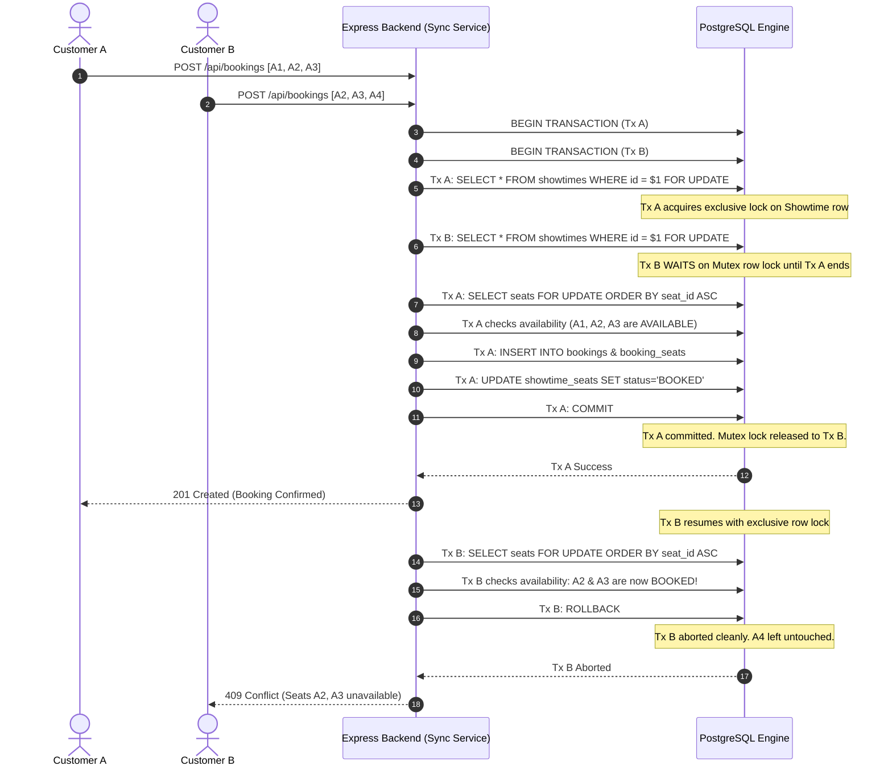

# 🍿 Cinema Group Ticket Booking System
### Full-Stack Cinema Ticket Booking Platform with Real PostgreSQL Row-Lock Mutex Synchronization

---

## 📌 1. Problem Statement & Architecture

In high-traffic cinema reservation systems, multiple customers often select overlapping cinema seats simultaneously. For example:
- **Customer A** attempts to book seats **[A1, A2, A3]**.
- **Customer B** simultaneously attempts to book seats **[A2, A3, A4]**.

Without atomic concurrency control, race conditions can lead to duplicate bookings, fragmented group allocations, or inconsistent database records.

This application solves this concurrency challenge at the **database engine level** using **PostgreSQL Transaction-based Row Locking (`SELECT FOR UPDATE`)**, deterministic seat lock ordering, and strict unique constraints.

### Key Guarantees
- 🔒 **Row-Level Mutex Synchronization**: Concurrent booking requests for the same showtime are synchronized safely by locking the showtime row.
- ⚛️ **Atomic Group Booking**: All requested adjacent seats are booked together inside one transaction. If even a single seat is unavailable, the entire booking is aborted atomically (`ROLLBACK`), with **zero** partial seat allocation.
- 🛡️ **Consistent Lock Ordering**: Seat IDs are sorted deterministically before acquiring row locks, mathematically preventing deadlocks.
- 🚫 **Database As Single Source of Truth**: Frontend state is never trusted. PostgreSQL unique constraints (`UNIQUE(showtime_id, seat_id)`) enforce physical consistency even in high-throughput environments.

---

## 🛠️ 2. Technology Stack

- **Frontend**:
  - React.js 18
  - Vite
  - React Router DOM v6
  - Axios
  - Modern Responsive CSS (Dark Blue & Crisp White Design System)
- **Backend**:
  - Node.js & Express.js
  - PostgreSQL & `pg` (node-postgres)
  - Embedded PostgreSQL fallback (Zero-configuration portable execution)
  - CORS, Dotenv
- **Concurrency & Database Synchronization**:
  - PostgreSQL explicit transactions (`BEGIN`, `COMMIT`, `ROLLBACK`)
  - Row-level Mutex locking (`SELECT FOR UPDATE`)
  - Unique composite constraints: `UNIQUE(showtime_id, seat_id)`

---

## 🗄️ 3. Database Schema

The database `cinema_booking` contains six normalized tables:

```
  +------------------+             +----------------------+
  |      movies      | 1 ------- * |      showtimes       |
  +------------------+             +----------------------+
                                              | 1
                                              |
                                              | *
  +------------------+             +----------------------+
  |      seats       | 1 ------- * |    showtime_seats    | (AVAILABLE / BOOKED)
  +------------------+             +----------------------+
           |                                  |
           |                                  |
           | *                              * |
  +-------------------------------------------------------+
  |                   booking_seats                       | (UNIQUE: showtime_id, seat_id)
  +-------------------------------------------------------+
                              | *
                              |
                              | 1
                   +----------------------+
                   |       bookings       | (CONFIRMED / CANCELLED)
                   +----------------------+
```

1. **`movies`**: `id`, `title`, `description`, `image_url`, `duration`, `created_at`
2. **`showtimes`**: `id`, `movie_id`, `show_date`, `show_time`, `ticket_price`, `created_at`
3. **`seats`**: `id`, `seat_number`, `row_name`, `CONSTRAINT unique_row_seat UNIQUE(row_name, seat_number)`
4. **`showtime_seats`**: `id`, `showtime_id`, `seat_id`, `status` (`AVAILABLE` / `BOOKED`), `UNIQUE(showtime_id, seat_id)`
5. **`bookings`**: `id`, `customer_name`, `customer_email`, `showtime_id`, `total_amount`, `booking_status`, `created_at`
6. **`booking_seats`**: `id`, `booking_id`, `showtime_id`, `seat_id`, `CONSTRAINT unique_showtime_seat_booking UNIQUE(showtime_id, seat_id)`

---

## 🔐 4. Mutex Synchronization Workflow

When a group booking request arrives at `POST /api/bookings`:



---

## 🚀 5. Getting Started & Setup Guide

### ⚡ Quick Start on Windows (One-Click)
Simply double-click:
```bat
start.bat
```
This batch script automatically:
1. Verifies Node.js installation.
2. Checks and installs missing dependencies if needed.
3. Starts the backend PostgreSQL and Express server on `http://localhost:5000`.
4. Starts the Vite React frontend on `http://localhost:3000`.
5. Automatically opens your browser to `http://localhost:3000`.

To run the Mutex Concurrency Test with one click, simply double-click:
```bat
test-concurrency.bat
```

---

### Manual Setup & Installation Steps

1. **Clone or Navigate to the Workspace**:
   ```bash
   cd "cinema-booking-system"
   ```

2. **Install Backend Dependencies**:
   ```bash
   cd backend
   npm install
   ```

3. **Install Frontend Dependencies**:
   ```bash
   cd ../frontend
   npm install
   cd ..
   ```

4. **Environment Variables**:
   Copy `.env.example` or adjust `backend/.env`:
   ```ini
   PGHOST=localhost
   PGPORT=5432
   PGUSER=postgres
   PGPASSWORD=password
   PGDATABASE=cinema_booking
   PORT=5000
   NODE_ENV=development
   ```

5. **Run Database Migrations & Seeds**:
   ```bash
   cd backend
   npm run migrate
   ```
   *Creates tables, constraints, indexes, 5 popular movies, 15 showtimes, 50 auditorium seats, and 750 seat allocations.*

---

## 🏃 6. Running the Application

### Start the Backend API Server:
```bash
cd backend
npm start
```
*Backend runs at `http://localhost:5000`.*

### Start the Frontend Client:
In a separate terminal:
```bash
cd frontend
npm run dev
```
*Frontend runs at `http://localhost:3000` (or the port Vite outputs).*

---

## 🧪 7. Running the Mutex Concurrency Test Suite

We provide two distinct ways to verify the PostgreSQL Mutex:

### Option A: Command-Line Automated Test Suite
With the backend server running, run:
```bash
cd backend
npm run test:concurrency
```

This automated suite runs 6 exhaustive concurrency tests:
1. **Simultaneous Overlapping Booking**: Customer A (`[A1, A2, A3]`) vs Customer B (`[A2, A3, A4]`). Verifies exactly one succeeds with 201, the other fails with 409, and zero partial seats are booked.
2. **Identical Seats Race Condition**: Customer C vs Customer D requesting the exact same seats simultaneously.
3. **Simultaneous Disjoint Bookings**: Two customers booking non-overlapping seats simultaneously (both succeed with 201).
4. **Group Booking with One Unavailable Seat**: Verifies complete transaction rollback.
5. **Booking Cancellation & Seat Release**: Cancels a booking, releases seats in a transaction, and verifies seats return to `AVAILABLE`.
6. **Input Validation**: Tests non-existent showtimes and seats.

### Option B: Interactive Visual Mutex Simulator in Frontend UI
1. Open `http://localhost:3000/concurrency-test` in your web browser.
2. Click **"🚀 Simulate Race Condition Now"**.
3. Watch the real-time execution logs, timings, HTTP status codes, and atomic rollback confirmation right on screen!

---

## 📡 8. REST API Reference

| Method | Endpoint | Description |
| :--- | :--- | :--- |
| `GET` | `/api/movies` | Fetch all movies with showtimes preview |
| `GET` | `/api/movies/:movieId` | Fetch movie details with showtimes list |
| `GET` | `/api/showtimes/:movieId` | Fetch showtimes for a specific movie |
| `GET` | `/api/seats/:showtimeId` | Fetch cinema seating grid & availability |
| `POST` | `/api/bookings` | **Atomic Mutex Group Booking** (`SELECT FOR UPDATE`) |
| `GET` | `/api/bookings/:bookingId` | Fetch booking details & tickets |
| `GET` | `/api/bookings` | Fetch all historical bookings |
| `DELETE` | `/api/bookings/:bookingId` | Safely cancel booking & release seats via transaction |
| `GET` | `/api/dashboard/stats` | Fetch real-time cinema metrics & stats |

---

## 🐳 9. Docker Deployment

To launch the full stack with official Docker images:
```bash
docker-compose up --build
```
- PostgreSQL: `localhost:5432`
- Express Backend: `localhost:5000`
- React Frontend: `localhost:3000`
